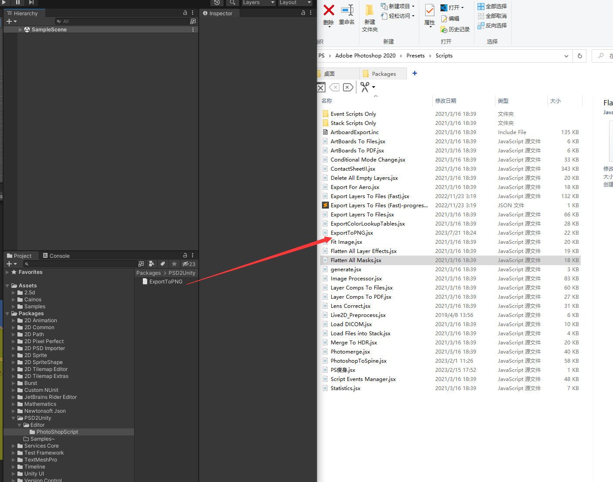
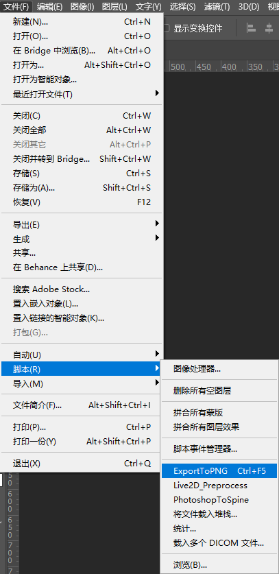
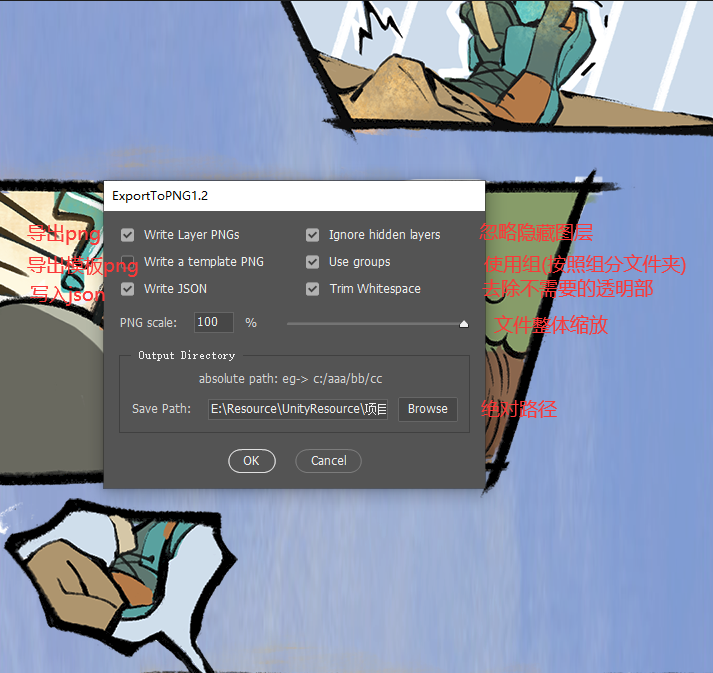
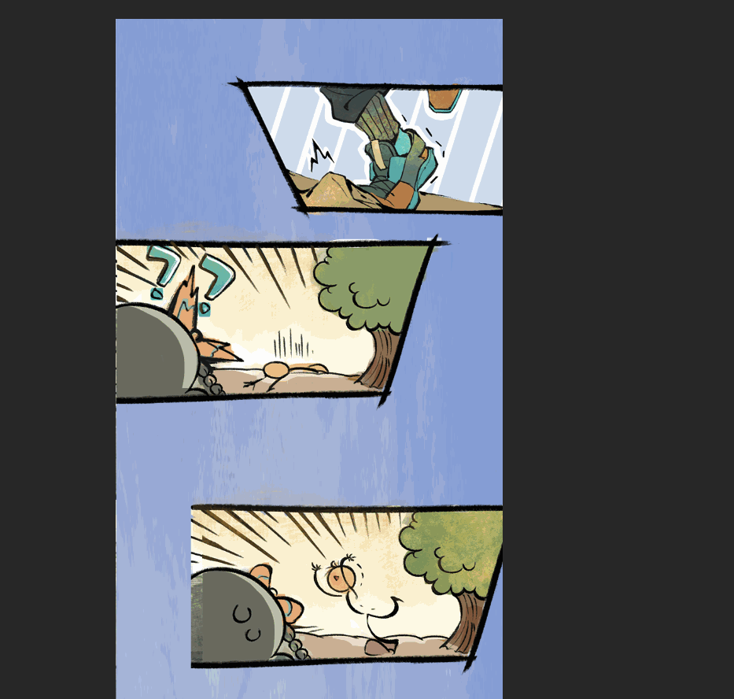
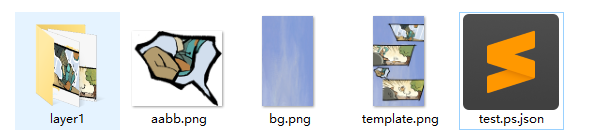
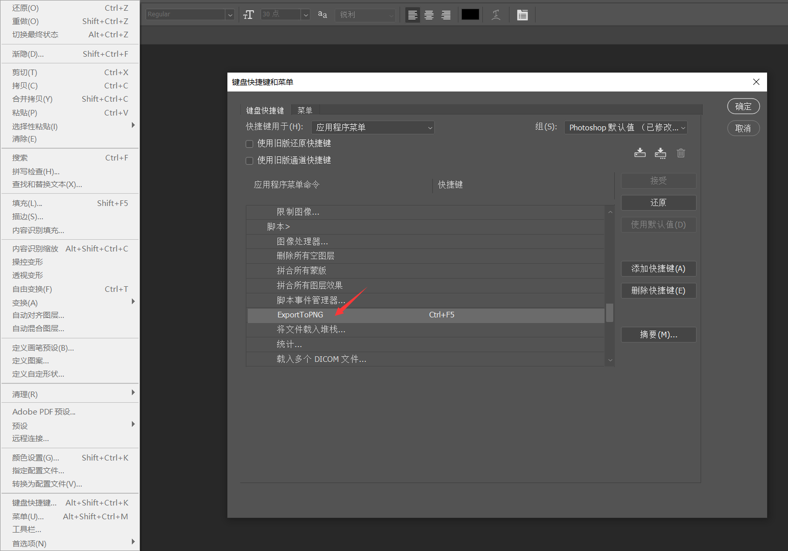
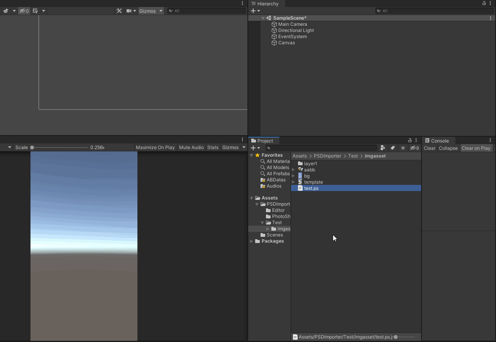

# PSD2Unity

**PS中导出切图到Untiy生成UGUI界面或场景**


## 原理

插件分为两部分

* photoshop脚本:用于放在ps中执行对图片的操作,最后导出散图和一个json样式的数据
* unity代码部分:读取json数据然后创建对于的物体


## 注意事项

* **PS中组名尽量不要重名(虽然1.1.0版本已经优化此功能,但建议还是不要重名)**
* **PS中同一个组下图层不要重名！！！(一个图层就是一张图，重名会导致只保存其中一个)**


## 如何使用

1. 通过UnityPackageManager导入包

2. 将`ExportToPNG` ps脚本放在PhotoShop软件`Scripts`文件夹

   

3. PS中操作

       

       

   * `Write Layer Pngs`  将ps中图层导出png
   * `Ignore hidden Layer` 忽略隐藏图层 ,如果勾选则不导出PS中隐藏图层
   * `Write a template PNG` 写入一张模板
   * `User groups` 是否使用组,勾选会按PS组导出
   * `Write Json` 是否导出json, Unity中会用到
   * `Trim Whitespace` 是否去除空白,不勾选则导出原始画布尺寸

   

    

   等待一段时间之后,在对应的文件夹会生成相应的资源文件

    

   ***

   tip:添加快捷键

   

4. 将生成的文件导入Unity中,然后将图片格式设置成`Sprite`

5. 选中生成的`xxx.ps.data`,然后右键`PSDTools/PSD2Scene`或者`PSDTools/PSD2UGUI`生成界面即可

   


---

## 其他

提供两个回调事件,用于自定义扩展,eg:

```c#
using UnityEngine;
using UnityEditor;
using PSDImporter;
using UnityEngine.UI;
public class EditorTools
{
    [InitializeOnLoadMethod]
    static void InitMethod()
    {
        //当创建图片时，如果图片不存在，则调用此方法
        PSDCreateor.OnPicMissing += PSDCreateor_OnPicMissing;
        //当创建游戏对象时，会调用此方法
        PSDCreateor.OnGameObjectCreated += PSDCreateor_OnGameObjectCreated;
    }

    private static void PSDCreateor_OnGameObjectCreated(GameObject go, string picName)
    {
        if (go.TryGetComponent(out Image img))
        {
            if (picName.Contains("_btn"))
                img.gameObject.AddComponent<Button>();
        }
        else if (go.TryGetComponent(out SpriteRenderer sr))
        {
            //xxx
        }
    }

    private static bool PSDCreateor_OnPicMissing(GameObject go, string picPath)
    {
        return true;
    }
}
```


## ChangeLog

### 1.1.1

* 增加了两个回调事件  `PSDCreateor.OnPicMissing`和`PSDCreateor.OnGameObjectCreated`(ps脚本仍然是1.1.0)

### 1.1.0

* 更新了`ps脚本(ExportToPNG)`,修复当组名有重复的情况,导出图路径和json文件路径错误问题, 需替换之前的脚本
* 重新命名了下`ps脚本(ExportToPNG)`的version,保持跟插件同步,现在都是1.1.0
* 删除了Sample示例

### 1.0.7

* 增加了当未找到图时回调事件,方便使用通用的小图


### 1.0.6

* 之前保存为.ps.json格式,现在改成.ps.data格式(.json会默认为unity的textasset,会参与打AssetBundle, .data则不会,参考:[Unity - Manual: Text assets (unity3d.com)](https://docs.unity3d.com/Manual/class-TextAsset.html))
* 不在自动生成Prefab预制体(自己手动拖一下吧)
* 调整代码,将菜单order=1500

### 1.0.5

* 修改成UnityPackage

### 1.0.4

* 修改了json结构,更加清晰明了

### 1.0.3

* 添加提示:同一个组下有相同图层名,导致未能正确保存问题

### 1.0.2

* 修复User groups(按组导出)时没有按照ps中结构正确生成组的bug
* 添加了导出png图片过大问题,也就是导出时写入了xmp数据导致图片内存异常大

### 参考

 ❤️ ❤️ ❤️ ❤️ ❤️

[Spine 2D - LayersToPNG.jsx fix for Photoshop CC (github.com)](https://gist.github.com/nzhul/5ef666d5960423fed0de)

[EsotericSoftware/spine-scripts: Scripts to export from PhotoShop and other tools to Spine's JSON data format. (github.com)](https://github.com/EsotericSoftware/spine-scripts)

[解决Photoshop CC导出JPG文件过大的问题)](https://www.peb.cc/windows/48.html)

### 其他

由于使用了`Newtonsoft.Json`(至少版本>=unity2021.3.16自带了)

如果提示缺失该程序集找到PSD2Unity下的`Editor/NewtonsoftJson~`把后面的`~`去除即可

